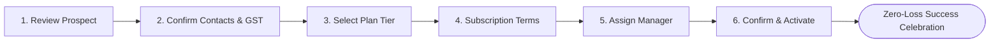

# Legal Sales CRM: Client Management Module Specification

## 1. Executive Module Architecture

The **Client Management Module** (`/clients`) manages paying law firms, advocates, and legal organizations throughout their customer lifecycle. It enforces zero-loss customer data continuity, ensuring that when an account converts from a prospect to a paying client, all historical demo recordings, meeting notes, Bar Council accreditations, and communications remain permanently accessible.

### 1.1 The Tri-State Client Lifecycle Architecture
The module is segmented into three dedicated views reflecting customer health:
1. **Active Clients (`/clients/active`)**: Current paying accounts in good standing with active subscription contracts.
2. **At-Risk Clients (`/clients/at-risk`)**: Accounts displaying early warning indicators (health score < 40, dropped usage > 30 days, failed payment dunning, or unresolved support disputes) prioritized for immediate retention outreach.
3. **Inactive & Expired Clients (`/clients/inactive`)**: Former clients whose contracts have expired or been cancelled. Records are never deleted; they preserve 100% of historical data, capture structured churn reasons, and feed automated win-back cadences.

---

## 2. Screen 1: Active Clients Listing

### 2.1 Table Columns & Data Attributes
| # | Column Name | Type / Format | Example Value |
| :--- | :--- | :--- | :--- |
| 1 | **Client Name** | String + Avatar + Bar ID | Adv. Rajesh Sharma (`D/1982/2012`) |
| 2 | **Phone Number** | Clickable Tel Link | `+91 98101 23456` |
| 3 | **Email Address** | Clickable Mailto Link | `sharma@apexlegal.in` |
| 4 | **Profession** | Categorized Tag | Senior Advocate & Managing Partner |
| 5 | **Firm Name** | String + Entity Icon | Apex Legal Partners (12 Seats) |
| 6 | **Plan Name** | Tier Badge | **Professional** (Chamber Pro) |
| 7 | **Subscription Type**| Tag | Annual Prepaid (10% Discount) |
| 8 | **Start Date** | Formatted Date | Nov 19, 2026 |
| 9 | **Renewal Date** | Date + Warning Badge | Nov 19, 2027 (In 365 Days) |
| 10 | **Payment Status** | Semantic Badge | `PAID` (Green) \| `PENDING` (Amber) \| `FAILED` (Red) |
| 11 | **Client Status** | Health Badge | `ACTIVE` (Green) \| `IN GRACE` (Amber) |
| 12 | **Account Manager** | Avatar + Name | Sarah Jenkins (CS Handover) |
| 13 | **Actions** | Action Toolbar | View 360°, Upgrade Plan, Record Payment, More `•••` |

---

## 3. Screen 2: Convert Prospect to Client (The 6-Step Conversion Flow)

The conversion wizard is a linear transaction modal ensuring complete financial and legal compliance before provisioning software licenses.

### 3.1 Step-by-Step Field Specifications
1. **Step 1: Review Prospect Information**:
   - Read-only review: Prospect Name, Law Firm, Current Sales Stage, Assigned Salesperson, Total Ingested Touchpoints (e.g., 14 recorded interactions).
2. **Step 2: Confirm Client Contact Information**:
   - Legal Entity Billing Name (for invoicing).
   - GSTIN / Tax Registration Number (optional/mandatory for Indian law firms).
   - Registered Chamber Address, City, State, PIN Code.
   - Primary Billing Contact & Phone.
3. **Step 3: Select Subscription Plan Tier**:
   - **Starter Plan** (Solo Advocate): ₹3,500 / month (1 Seat, Supreme Court & High Court judgments).
   - **Professional Plan** (Chambers Pro): ₹18,000 / month (Up to 12 Seats, Cause-List Sync, Case Diary).
   - **Enterprise Plan** (Law Firm Suite): ₹45,000 / month (Unlimited Seats, API Integrations, SLA Support).
4. **Step 4: Enter Subscription & Billing Terms**:
   - **Subscription Cadence**: Monthly, Quarterly, Annual (10% Discount), Multi-Year.
   - **Contract Value / Amount**: Auto-calculated based on tier + additional seats + discount overrides.
   - **Start Date**: Defaults to today.
   - **Renewal Date**: Auto-calculated (e.g., Today + 365 days for Annual).
   - **Payment Status**: `Paid (Transaction Verified)` \| `Pending Payment (Net 15 Invoice)` \| `Trial Activation`.
   - **Payment Reference / UTR Number**: Bank reference (NEFT/RTGS/UPI/Razorpay Order ID).
5. **Step 5: Assign Account Manager & CS Onboarding**:
   - Assign dedicated Customer Success / Account Manager (defaults to closing sales rep or dedicated onboarding specialist).
   - Schedule initial team onboarding session.
6. **Step 6: Confirm Conversion**:
   - Summary ledger detailing account name, total annual value, seat licenses, and billing frequency.
   - Confirmation checkbox: *"I confirm payment terms have been validated."*

### 3.2 Post-Conversion System Mutation
Upon clicking `"Confirm & Activate Client"`:
- The customer record lifecycle state mutates: `status: CLIENT_ACTIVE`.
- Ingestion of `conversion_timestamp = now()`.
- Generation of `Subscription` and `Invoice` records.
- 100% of historical calls, emails, demos, and internal comments remain intact on the unified timeline.
- The user is greeted with a celebratory success modal with a 1-click CTA: `Go to Client 360° Profile ➔`.

---

## 4. Screen 3: Client Details (Client 360° Profile Hub)

### 4.1 Master Header & Subscription Summary Card
- **Client Overview**:
  - Legal Entity Name: Apex Legal Partners (`D/1982/2012`).
  - Contact Advocate: Senior Adv. Rajesh Sharma.
  - Direct Phone, Email, Chamber Address.
  - Assigned Account Manager: Sarah Jenkins.
- **Subscription Details Card**:
  - Current Plan: **Professional (Chambers Pro)**.
  - Subscription Type: **Annual Prepaid**.
  - Contract Value: **₹2,16,000 / year (₹18,000 / mo)**.
  - Term: **Nov 19, 2026 – Nov 19, 2027**.
  - Seat Allocation: **12 Active Advocate Licenses**.
  - Payment Status: `PAID (Tx: NEFT-HDFC-99124)`.
  - Client Health Score: `94 / 100 (Healthy Usage)`.

### 4.2 The 6 Client Tabs
1. **Overview Tab**:
   - Organization hierarchy (Managing partners, associates, chamber clerks).
   - Practice domains (Litigation, Corporate M&A, Arbitration).
   - Feature entitlement audit (Cause-list sync active, judgment headnote search active).
2. **Activity Timeline Tab**:
   - Seamlessly preserves all pre-conversion sales touchpoints (calls, zoom recordings) along with post-conversion onboarding logs and quarterly business reviews.
3. **Subscription History Tab**:
   - Immutable audit trail of every plan change, tier upgrade/downgrade, seat expansion, and term renewal with effective dates and revenue deltas.
4. **Payments & Invoices Tab**:
   - Tabular ledger of all issued GST tax invoices, payment dates, amounts, download invoice PDF links, and payment method details.
5. **Internal Notes Tab**:
   - Private team strategy comments, partner fee arrangements, and renewal negotiation notes.
6. **Follow-ups Tab**:
   - Scheduled customer success check-ins, quarterly feature reviews, and annual renewal reminders.

---

## 5. Client Action Workflows (10 Modal & State Handlers)

1. **Edit Client**: Update firm address, billing email, contact advocate, or GSTIN.
2. **Change Plan / Upgrade Plan**: Modal allowing reps to transition from Starter to Professional or Enterprise with immediate pro-rated fee adjustments.
3. **Downgrade Plan**: Warning modal requiring customer reason before scheduling end-of-term downgrade.
4. **Renew Subscription**: Pre-fills existing terms with options to apply annual discount or add more advocate seats.
5. **Record Payment**: Log offline bank NEFT/RTGS receipts, update payment status to `PAID`, and issue tax invoice.
6. **Add Follow-up**: Schedule post-sale check-ins and review meetings.
7. **Add Comment**: Private team strategy scratchpad.
8. **Mark Inactive (Churn Logging)**:
   - Structured legal churn reasons: *Firm dissolved/split*, *Budget cut*, *Court recess seasonality*, *Missing specific court coverage*, *Switched to competitor*, *Dormant practice*.
   - Qualitative exit interview notes.
   - Moves account to `/clients/inactive` without deleting data.
9. **Cancel Subscription**: Immediate or end-of-term cancellation modal with win-back task scheduler.
10. **Reactivate Client**: 1-click restoration from `/clients/inactive` back into active status with new plan selection.
