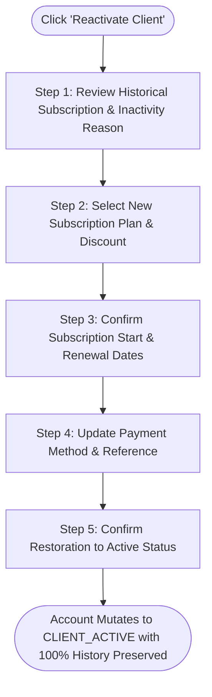

# Legal Sales CRM: Inactive & At-Risk Clients Module Specification

## 1. Executive Module Overview

The **Inactive and At-Risk Clients Module** (`/clients/retention`) safeguards recurring revenue (ARR/MRR) for the legal technology company. Its twin objectives are:
1. **Early Churn Interception (At-Risk Clients)**: Proactively identifying accounts exhibiting behavioral or financial churn signals (approaching expiry, failed payments, dropped usage, formal cancellation requests, or partner dissatisfaction) to trigger targeted retention workflows before churn occurs.
2. **Win-Back Recovery (Inactive Clients)**: Managing expired, cancelled, and lapsed law firm accounts through structured win-back cadences, alternative plan offerings, and a seamless 1-click **Reactivation Flow** that restores accounts to active standing with complete data continuity.

---

## 2. Risk Detection & Inactivity Taxonomy

### 2.1 The 5 At-Risk Signal Triggers
Accounts are automatically flagged as `CLIENT_AT_RISK` upon triggering any of the following rules:
| Trigger Code | Trigger Description | Severity Level | Automated Action Triggered |
| :--- | :--- | :--- | :--- |
| `RISK_EXPIRY` | Subscription term ending in ≤ 14 days without renewal sign-off. | ⚠️ High | Spawns "Renewal Outreach" task for assigned rep. |
| `RISK_PAYMENT` | Failed credit card debit or invoice unpaid past Net 15 terms. | 🚨 Urgent | Flags payment dunning; sends automated bank reminder. |
| `RISK_CANCEL_REQ`| Managing Partner or clerk submitted formal cancellation notice. | 🚨 Urgent | Escalates to Sales Manager for partner intervention. |
| `RISK_DISSATISFIED`| Negative NPS/CSAT (< 6), escalated support dispute, or missing citation complaint. | ⚠️ High | Spawns "Practice Review Meeting" with CS lead. |
| `RISK_ENGAGEMENT` | Platform login drop > 60% or zero judgment searches in 30 days. | 🟡 Medium | Flags dormant usage; triggers feature re-orientation email. |

### 2.2 The 7 Standardized Inactivity Reasons
When an account lapses or cancels, the CRM requires selecting one of seven standardized reasons:
1. **Pricing Concerns**: Plan fees exceed chamber budget; requested lower rate.
2. **Not Using the Product**: Low adoption; associates continue using legacy physical digests.
3. **Switched to Another Solution**: Churned to a competitor (SCC Online, Manupatra, Legitquest).
4. **Product Requirements Not Met**: Missing specific court jurisdiction, local tribunal, or niche practice module.
5. **Temporary Requirement**: Trial completed or single high-stakes appellate matter concluded (court recess seasonality).
6. **Payment Issues**: Persistent banking, credit limit, or invoicing compliance failure.
7. **Other**: Chamber split, partner retirement, or organizational restructuring.

---

## 3. Table Column Specifications

Both the **At-Risk Clients** and **Inactive Clients** views share a unified high-density data table with context-aware column formatting:

| # | Column Name | Data Type & Mapping | Visual Formatting & Semantics |
| :--- | :--- | :--- | :--- |
| 1 | **Client Name** | String + Avatar + Bar ID | Bold legal name (`#202938`), Bar Enrollment ID sub-label (e.g. `D/1982/2012`). |
| 2 | **Phone Number** | Tel URI Link | Clickable 1-click VoIP call link (`+91 98101 23456`). |
| 3 | **Email Address** | Mailto Link | Clickable secondary email (`sharma@apexlegal.in`). |
| 4 | **Previous Plan** | Plan Tier Badge | Starter (`#F1F5F9`), Professional (`#EFF6FF`), Enterprise (`#F5F3FF`). |
| 5 | **Subscription End Date**| Date + Countdown | Formatted date + relative indicator (e.g. `Expired 22 days ago` or `In 12 days`). |
| 6 | **Inactivity Reason / Risk**| Category Pill | Inactivity Reason tag OR At-Risk Severity pill with icon. |
| 7 | **Last Contact Date** | Relative Timestamp | Days elapsed since last call, meeting, or email exchange. |
| 8 | **Next Follow-up** | Date + SLA Badge | Overdue (`Red`), Due Today (`Amber`), or Scheduled (`Gray`). |
| 9 | **Assigned Salesperson** | Rep Avatar + Name | Circular initials badge + short name (`Sarah J.`). |
| 10 | **Retention Status** | Status Badge | `Outreach Initiated`, `Offer Sent`, `Under Review`, `Win-Back Scheduled`, `Unresponsive`. |
| 11 | **Actions** | Action Toolbar | 1-click Contact, Offer Alternative Plan, Reactivate Client, Mark as Lost. |

---

## 4. The 6 Core Retention Actions

1. **Contact Client**: Launches 1-click softphone dialer, WhatsApp message composer, or personalized outreach email.
2. **Schedule Follow-up**: Creates a high-urgency retention task with automated calendar reminder.
3. **Add Internal Comment**: Private scratchpad for recording partner negotiation dynamics and discount approvals.
4. **Offer Alternative Plan**:
   - **Chamber Pause Plan**: Freezes subscription for 30–60 days during court summer/winter recess without losing data.
   - **Downgrade to Starter**: Preserves advocate access at lower price point (₹3,500/mo).
   - **Retention Discount**: Allows sales reps to apply an approved 15–20% discount on annual renewals.
5. **Reactivate Client**: Opens the 5-step Reactivation Flow to restore the account to active status.
6. **Mark as Lost**:
   - Moves the account out of active retention cadences into cold archive.
   - Requires user confirmation to avoid accidental abandonment of valuable legal relationships.

---

## 5. Screen Specification: The 5-Step Client Reactivation Flow

When a former client agrees to return, clicking `"Reactivate Client"` launches a streamlined restoration wizard:

### Step-by-Step Reactivation Fields:
- **Step 1: Review Previous Subscription**:
  - Displays former tier (*Professional - 12 Seats*), previous contract value, historical cancellation date, and recorded churn reason (*"Pricing Concerns"*).
- **Step 2: Select New Subscription Plan**:
  - Select tier: Starter, Professional, or Enterprise.
  - Apply custom retention discount (e.g. 15% Win-Back Discount).
  - Allocate required advocate seats.
- **Step 3: Confirm Subscription Dates**:
  - New Contract Start Date: Defaults to today (`Nov 19, 2026`).
  - New Renewal Date: Auto-calculated based on cadence (`Nov 19, 2027` for Annual).
- **Step 4: Update Payment Status & Reference**:
  - Status: `Paid (Bank Transfer Verified)` \| `Pending Net 15 Invoice` \| `Trial Grace Period`.
  - Transaction Reference / UTR Number.
- **Step 5: Confirm & Restore**:
  - Mutates account state from `CLIENT_INACTIVE` to `CLIENT_ACTIVE`.
  - Appends a `"Client Reactivated"` milestone to the unified timeline.
  - Retains all pre-existing call recordings, historical invoices, and notes.

---

## 6. Empty States & Confirmation Safeguards

### 6.1 At-Risk Empty State (Clean Health)
- When no accounts meet risk criteria:
  - Visual: Green shield with checkmark badge.
  - Headline: `"All Client Accounts in Good Health"`
  - Body: *"No law firms have upcoming expirations, failed payments, or dropped engagement scores in this view."*
  - CTA: `View Active Clients Roster ›`

### 6.2 Mark as Lost Confirmation Dialog
- Danger dialog warning against permanently giving up on an advocate:
  - Title: `Mark Client as Permanently Lost?`
  - Body: *"This will remove **Adv. Alok Verma (Verma & Co. Advocates)** from active retention follow-up queues. All historical logs will remain preserved in the permanent archive."*
  - Buttons: `Cancel` \| `Confirm Mark as Lost`.
