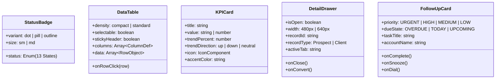

# Legal Sales CRM: Design System Specification & Component Library

## 1. Visual Foundation & Design Tokens

This design system establishes a minimal, high-clarity, professional B2B SaaS interface tailored for legal technology sales. It synthesizes the clean aesthetics of modern CRM references—crisp white surfaces, delicate borders, high-contrast slate typography, and compact tables—while solving legal-specific density requirements.

### 1.1 Color Tokens & Semantic Roles

| Token Name | Hex Code | Semantic Role & Application |
| :--- | :--- | :--- |
| `--bg-primary` | `#FFFFFF` | Main canvas, table rows, cards, slide-over sheets, modals. |
| `--bg-secondary` | `#F7F8FA` | Sidebar background, table header bar, KPI card subtle fills, badge backdrops. |
| `--bg-tertiary` | `#F1F3F6` | Input disabled backgrounds, hover surfaces on muted items. |
| `--text-primary` | `#202938` | Primary headlines, table data values, customer/firm names, button text. |
| `--text-secondary` | `#667085` | Subtitles, table header labels, metadata, timestamps, input placeholders. |
| `--text-tertiary` | `#98A2B3` | Secondary icons, inactive pagination controls, breadcrumb dividers. |
| `--action-primary` | `#2563EB` | Primary CTA buttons, active sidebar tabs, focused input rings, link highlights. |
| `--action-hover` | `#1D4ED8` | Hover state for primary action buttons. |
| `--action-subtle` | `#EFF6FF` | Selected row highlight, active tab background, light blue badges. |
| `--border-default` | `#E5E7EB` | Dividers, card outlines, table borders, input field strokes. |
| `--border-subtle` | `#F2F4F7` | Inner cell dividers, secondary separator lines. |
| `--color-success` | `#16A36A` | Converted deals, active client status, positive growth metrics. |
| `--color-warning` | `#E9A23B` | At-risk flags, pending approvals, demo due alerts, mid-tier urgency. |
| `--color-error` | `#DC5252` | Cancelled subscriptions, lost deals, overdue follow-ups, validation errors. |

### 1.2 Spacing System (8px Grid)
All padding, margins, row heights, and layout gaps strictly adhere to an 8px modular baseline:
- `space-1` (4px): Tight badge internal padding, icon-to-label inline gaps.
- `space-2` (8px): Button internal padding (vertical), cell gap, small icon buttons.
- `space-3` (12px): Compact input padding, small card gap.
- `space-4` (16px): Standard container padding, card header-to-body, grid gap.
- `space-5` (20px): Table cell horizontal padding.
- `space-6` (24px): Page section spacing, drawer padding.
- `space-8` (32px): Major layout divisions, modal padding.
- `space-12` (48px): Page header-to-content gutter.

### 1.3 Typography Hierarchy (Inter / Geist)
Clean, geometric grotesk type with tabular numeral support for financial values and dates.

```
┌──────────────────┬──────────────┬─────────────┬─────────────┬──────────────────────────────────────────┐
│ Style Role       │ Font Size    │ Line Height │ Font Weight │ Typical Usage                            │
├──────────────────┼──────────────┼─────────────┼─────────────┼──────────────────────────────────────────┤
│ Page Title       │ 24px (1.5rem)│ 32px        │ SemiBold 600│ Screen headings (e.g. "Prospects")       │
│ Section Title    │ 18px (1.125) │ 26px        │ SemiBold 600│ KPI section title, drawer titles         │
│ Subsection Title │ 16px (1.0rem)│ 24px        │ Medium 500  │ Card headers, modal group headers        │
│ Body Regular     │ 14px (0.875) │ 20px        │ Regular 400 │ Form inputs, timeline notes, modal body  │
│ Body Medium      │ 14px (0.875) │ 20px        │ Medium 500  │ Button labels, active tab titles         │
│ Table Content    │ 13.5px       │ 18px        │ Regular 400 │ Table cells, contact emails, firm names  │
│ Table Header     │ 12.5px       │ 16px        │ Medium 500  │ Sticky column titles (all caps or title) │
│ Supporting Label │ 12px (0.75)  │ 16px        │ Medium 500  │ Badges, timestamps, helper text, metrics │
│ Micro Monospace  │ 11px         │ 14px        │ Regular 400 │ Bar Council IDs, GSTIN, Invoice numbers  │
└──────────────────┴──────────────┴─────────────┴─────────────┴──────────────────────────────────────────┘
```

### 1.4 Surface Elevation & Shadow Discipline
To maintain the clean, minimal aesthetic:
- **No heavy drop shadows**: Use `#E5E7EB` 1px borders instead of box-shadows for cards and containers.
- **Card Shadow**: `0 1px 2px 0 rgba(16, 24, 40, 0.05)` (barely perceptible elevation).
- **Dropdown / Flyout Shadow**: `0 4px 6px -1px rgba(0, 0, 0, 0.08), 0 2px 4px -2px rgba(0, 0, 0, 0.04)`.
- **Slide-over Drawer Shadow**: `-4px 0 24px 0 rgba(0, 0, 0, 0.06)`.
- **Modal Overlay Backdrop**: `rgba(32, 41, 56, 0.45)` with `backdrop-filter: blur(2px)`.

---

## 2. Status Design System (The 13 Core States)

The CRM enforces strict visual semantics across both the Prospect Pipeline and Client Lifecycle. Each badge combines a subtle tinted background (10-15% tint), a solid text label, a 1px border matching the tint, and an optional 6px status dot.

| Status Name | Category | Background Tint | Text / Dot Color | Border Color | Meaning & Trigger |
| :--- | :--- | :--- | :--- | :--- | :--- |
| **New Lead** | Prospect | `#F1F5F9` | `#475569` | `#CBD5E1` | Newly ingested law firm/advocate; uncontacted. |
| **Contacted** | Prospect | `#F0F9FF` | `#0284C7` | `#BAE6FD` | Outreach initiated via call/email; awaiting reply. |
| **Demo Scheduled**| Prospect | `#EEF2FF` | `#4F46E5` | `#C7D2FE` | Product demonstration confirmed on calendar. |
| **Demo Completed**| Prospect | `#F5F3FF` | `#7C3AED` | `#DDD6FE` | Demo conducted; notes & seat count recorded. |
| **Interested** | Prospect | `#FFFBEB` | `#D97706` | `#FDE68A` | Partner expressed buying intent; pricing requested. |
| **Negotiation** | Prospect | `#EFF6FF` | `#2563EB` | `#BFDBFE` | Proposal submitted; contract or discount pending. |
| **Converted** | Milestone| `#ECFDF5` | `#16A36A` | `#A7F3D0` | Closed Won! Plan selected; client record generated. |
| **Lost** | Prospect | `#FFF1F2` | `#E11D48` | `#FECDD3` | Prospect declined; reason recorded. |
| **Active** | Client | `#F0FDF4` | `#16A34A` | `#BBF7D0` | Paying client with healthy login and usage score. |
| **At Risk** | Client | `#FFF7ED` | `#EA580C` | `#FED7AA` | Usage dropped >40% or payment failed; intervention needed. |
| **Expired** | Client | `#F8FAFC` | `#64748B` | `#E2E8F0` | Contract term ended without renewal; in grace period. |
| **Cancelled** | Client | `#FEF2F2` | `#DC2626` | `#FECACA` | Client explicitly terminated plan; churn logged. |
| **Inactive** | Client | `#F3F4F6` | `#6B7280` | `#E5E7EB` | Dormant account; archived for future win-back campaigns. |

---

## 3. The 19 Reusable Component Specifications

### Component 1: Sidebar Navigation
- **Dimensions**: Fixed 240px width (expandable from 68px collapsed mode). Full height `100vh`.
- **Anatomy**:
  1. *Header (64px)*: LegalCRM Pro logo + collapse toggle icon.
  2. *Workspace Selector*: Dropdown showing current regional jurisdiction (e.g. `Delhi High Court & NCR ▾`).
  3. *Navigation Clusters*:
     - *Overview*: Dashboard
     - *Pipeline & Accounts*: Prospects, Clients (nested: Active, Inactive, At-Risk)
     - *Operations*: Follow-ups (with dynamic pill badge for overdue tasks), Plans & Subscriptions
     - *Intelligence*: Reports & Analytics
     - *Management*: Team Management, Settings
  4. *Footer*: Current user mini-profile (Avatar, Name, Role tag "Sales Exec", Logout icon button).
- **States**: Default, Hover (`bg-[#F7F8FA]`), Active (`bg-[#EFF6FF] text-[#2563EB] font-medium border-r-2 border-[#2563EB]`).

### Component 2: Top Navigation (Header Bar)
- **Dimensions**: Height 64px, `sticky top-0 z-30`, border-bottom `1px solid #E5E7EB`, background `#FFFFFF`.
- **Anatomy**:
  - *Left*: Context Breadcrumbs (e.g. `Prospects / High Court Litigation Pipeline`).
  - *Center*: Universal Search Input Trigger (`⌘K` Quick Search for Firms, Advocates, Deals).
  - *Right*:
    - Global Quick-Add Button (`+ Quick Add` with dropdown for New Prospect, Log Call, Task).
    - SLA / Urgency Alert Pill (`3 Overdue Tasks` in soft amber).
    - Notification Bell with red unread dot.
    - User Avatar with status dot.

### Component 3: KPI Stat Cards
- **Dimensions**: Auto-width, minimum 220px, height ~100px.
- **Anatomy**:
  - Top row: Metric Label (13px, `#667085`) + Category Icon (soft tinted circular badge).
  - Middle: Primary Metric Value (24px SemiBold, `#202938`, tabular numbers).
  - Bottom row: Trend Delta badge (`+14.2% vs last month` with green up-arrow) + contextual note.
- **Variants**: Standard White, Tinted Border (for Alert/At-Risk KPI cards).

### Component 4: Data Tables (Compact & High-Density)
- **Grid Layout**: Sticky table header, `1px solid #E5E7EB` bottom border.
- **Row Heights**: Compact 40px, Standard 48px.
- **Features**:
  - Leftmost column: Indeterminate master checkbox + row checkboxes.
  - Sticky right action column: Quick-action icons (View, Log Call, Edit, More `•••`).
  - Row Hover: Background transitions to `#F9FAFB`.
  - Row Selected: Background `#EFF6FF` with `#2563EB` subtle left indicator.
  - Floating Bulk Selection Action Bar: Pops up at bottom-center when ≥1 row selected (`2 Selected • Reassign Rep • Export CSV • Delete • Close`).

### Component 5: Search Fields
- **Anatomy**: Leading search icon (16px, `#667085`), placeholder text ("Search firms, lawyers, phone..."), trailing `⌘K` badge or clear `×` icon.
- **Variants**: Small (32px for tables), Medium (38px for page headers), Large (44px for global command search).
- **Focus State**: `border-[#2563EB] ring-2 ring-[#2563EB]/20 bg-[#FFFFFF]`.

### Component 6: Filter Dropdowns
- **Trigger**: Button with Filter icon + Dimension Name + Active Count pill + Chevron (`Status: 2 Selected ▾`).
- **Popover Panel**: Elevated card (280px wide) featuring:
  - Mini search field (e.g. "Search practice areas...").
  - Checkbox selection list with item count pills.
  - Action footer: "Clear All" link and "Apply Filter" primary button.

### Component 7: Date Pickers & Range Selectors
- **Trigger**: Calendar icon + Date range string (`Nov 01, 2026 – Nov 19, 2026 ▾`).
- **Popover**: Segmented preset list (Today, Yesterday, Last 7 Days, This Month, Last Quarter, Custom) + dual-month interactive calendar grid.

### Component 8: Status Badges
- **Dimensions**: Height 24px, horizontal padding 8px, border-radius 12px (rounded-full).
- **Typography**: 12px Medium font.
- **Anatomy**: 6px circular dot indicator + Status text label.

### Component 9: Avatar Components
- **Sizes**: XS (24px), SM (32px), MD (40px), LG (48px).
- **Variants**:
  - Photo avatar with crisp border.
  - Initials fallback (e.g. `SJ` on soft blue `#DBEAFE`).
  - Entity/Firm icon avatar (Scales of justice icon on slate background).
  - Online/Active status badge indicator at bottom-right corner.

### Component 10: Pagination
- **Layout**: Space-between flex bar directly below data tables.
- **Left**: `Showing 1–25 of 148 results` + `Rows per page: [25 ▾]`.
- **Right**: Button group: `‹ Previous`, `1`, `2 (Active)`, `3`, `...`, `6`, `Next ›`.

### Component 11: Action Menus (Kebab `•••` Dropdowns)
- **Trigger**: 32px square ghost icon button.
- **Menu Container**: Elevated white card (180px width) with 4px border radius.
- **Items**: Icon + text (e.g. "Log Call", "Schedule Demo", "Reassign Rep", divider, "Mark as Lost" [Red text]).

### Component 12: Confirmation Dialogs (Modals)
- **Dimensions**: Max-width 480px, centered on viewport with darkened backdrop blur.
- **Anatomy**:
  - Header: Semantic Icon badge (e.g. Warning Amber or Danger Red) + Dialog Title.
  - Body: 14px descriptive explanation of consequence.
  - Footer: Right-aligned button pair: "Cancel" (Outlined) + "Confirm Action" (Filled Semantic).

### Component 13: Right-Side Detail Drawers (Peek Drawer)
- **Dimensions**: Fixed 640px width (for conversion and 360° views) or 480px width (for quick inspections).
- **Anatomy**:
  - Header (56px): Record Name + Status Badge + Close `×` button.
  - Sub-header: Quick Action bar (Call, Email, Add Note, Convert CTA).
  - Body: Scrollable tabbed panels (Overview, Contacts, Timeline, Tasks, Plan & Billing).
  - Sticky Footer: Save changes / Next action primary bar.

### Component 14: Form Fields
- **Anatomy**: Label (13px Medium, `#202938`) + optional required asterisk `*` + Input box (38px height, `1px solid #E5E7EB`) + Helper text / Error message (12px).
- **Variants**: Text, Number, Select Dropdown, Multi-line Textarea, Checkbox, Toggle Switch.

### Component 15: Activity Timeline
- **Layout**: Vertical timeline with continuous 2px gray connector line.
- **Event Node**:
  - Left: Channel Icon badge (Phone Call [Blue], Demo [Purple], Email [Sky], Note [Slate]).
  - Right Card: Author name, timestamp ("Today, 11:30 AM"), title, expandable notes, audio recording player link or meeting transcript snippet.

### Component 16: Follow-Up Cards
- **Dimensions**: Bordered card (320px or full width in queue).
- **Anatomy**:
  - Left status strip: Red (Overdue), Amber (Due Today), Blue (Scheduled).
  - Top row: Priority tag (`URGENT`) + Due Date badge.
  - Middle: Action title ("Follow up on Chambers Pro 5-seat proposal") + Law Firm link.
  - Bottom: 1-click execution buttons: Complete checkmark, Dial phone icon, Reschedule clock icon.

### Component 17: Empty States
- **Anatomy**:
  - Centered layout inside container.
  - Muted icon in a 48px circular gray container (`#F1F3F6`).
  - Title: 16px SemiBold ("No prospects found in this view").
  - Description: 13px Secondary text ("Try clearing your filters or add a new prospect to begin.").
  - CTA Button: `+ Add New Prospect`.

### Component 18: Loading States (Skeleton Loaders)
- **Implementation**: Shimmering pulsing blocks (`animate-pulse bg-[#F2F4F7]`) matching exact geometry:
  - Table skeleton: 5 rows with alternating cell widths.
  - Card skeleton: Rectangular title block + large metric block.
  - Avatar skeleton: 32px circle.

### Component 19: Toast Notifications
- **Position**: Floating bottom-right or top-right (`z-50`).
- **Anatomy**: Left status icon + Title ("Client Converted") + Description ("Apex Legal has been activated on Chamber Pro Plan.") + Close `×` icon.
- **Variants**: Success (Green), Info (Blue), Warning (Amber), Error (Red).

---

## 4. Component Properties & Variant Matrix


