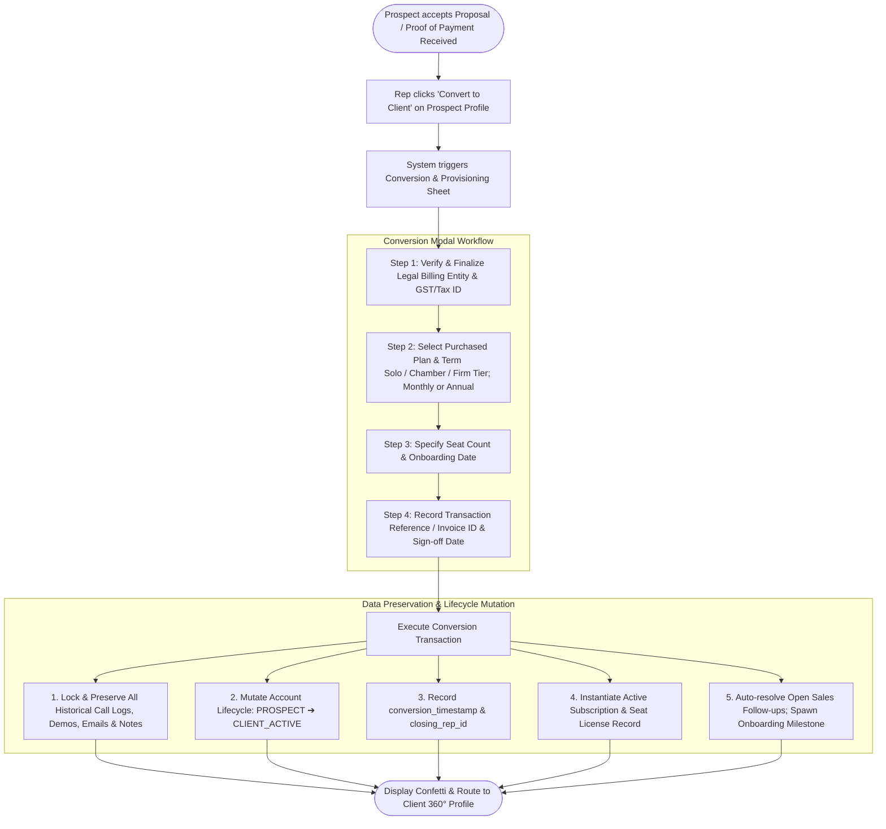
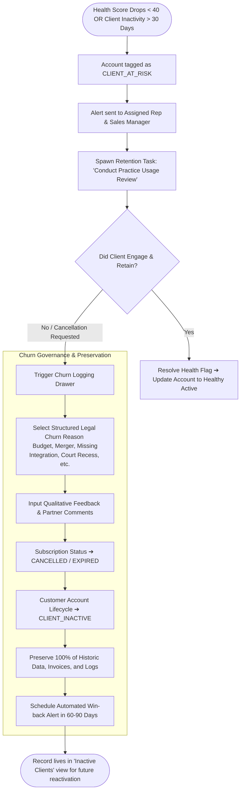

# Legal Sales CRM: Comprehensive UX Architecture & Product Design Specification

## Executive Architectural Summary
This document establishes the UX Architecture, Information Architecture (IA), Data Models, Role-Based Access Control (RBAC), User Journeys, and Screen Inventory for a specialized B2B SaaS CRM tailored for the legal technology industry.

The platform serves an internal sales team targeting legal personas—from solo advocates and chamber counsels to boutique partnerships and enterprise law firms. Unlike generic CRMs, this platform embodies legal-specific constructs (chambers, practice domains, bar jurisdictions, court tiers, compliance safeguards) and implements a **Unified Account Lifecycle Model** where Prospects and Clients are states of a continuous customer journey, guaranteeing zero data loss across conversion, churn, and reactivation.

---

## 1. Product Sitemap

The sitemap articulates the complete functional footprint of the Legal Sales CRM across its eight core modules, top utility layers, and global contextual overlays.

```mermaid
flowchart TD
    AppRoot["Legal Sales CRM Root"]
    
    %% Top Bar Global Overlays
    TopBar["Global Top Bar & System Trays"]
    AppRoot --> TopBar
    TopBar --> GlobalSearch["Omni-Search (⌘K) [Firms, Lawyers, Deals, Tasks]"]
    TopBar --> QuickAdd["Global Quick-Add (+) [New Prospect, Log Activity, Task, Meeting]"]
    TopBar --> NotifCenter["Notification & SLA Alert Drawer"]
    TopBar --> UserProfile["User Profile & Workspace Preferences"]

    %% Navigation Pillars
    AppRoot --> M1["1. Dashboard"]
    AppRoot --> M2["2. Prospects"]
    AppRoot --> M3["3. Clients"]
    AppRoot --> M4["4. Follow-ups"]
    AppRoot --> M5["5. Plans & Subscriptions"]
    AppRoot --> M6["6. Reports & Analytics"]
    AppRoot --> M7["7. Team Management"]
    AppRoot --> M8["8. Settings"]

    %% Module 1: Dashboard
    M1 --> D_Exec["My Desk (Sales Executive)"]
    M1 --> D_Mgr["Team Cockpit (Sales Manager)"]
    M1 --> D_Admin["Revenue Operations & Executive Overview"]

    %% Module 2: Prospects
    M2 --> P_Pipeline["Visual Pipeline (Kanban by Stage)"]
    M2 --> P_List["Prospect Directory (Data Grid / Table)"]
    M2 --> P_Detail["Prospect 360° Profile (Activity, Timeline, Conversion Action)"]
    M2 --> P_Import["Bulk Import & Practice Enrichment"]

    %% Module 3: Clients
    M3 --> C_Active["3.1 Active Clients (Accounts, Tiers, Seat Utilization)"]
    M3 --> C_Inactive["3.2 Inactive & Expired Clients (Churn Archive, Reactivation)"]
    M3 --> C_AtRisk["3.3 At-Risk Clients (Health Score, Inactivity Triggers, SLA Warnings)"]
    M3 --> C_Detail["Client 360° Profile (Contract, History, Renewals, Invoicing)"]

    %% Module 4: Follow-ups
    M4 --> F_Queue["Daily Task Worklist (Due Today, Overdue, Scheduled)"]
    M4 --> F_Calendar["Interactive Calendar (Calls, Demos, Court Syncs)"]
    M4 --> F_Cadence["Outreach Cadences & Legal Demo Workflows"]

    %% Module 5: Plans & Subscriptions
    M5 --> S_Catalog["Product Tier Catalog (Solo, Chamber, Firm, Enterprise)"]
    M5 --> S_ActiveSubs["Active Subscriptions Ledger"]
    M5 --> S_Renewals["Upcoming Renewals & Invoicing Pipeline"]
    M5 --> S_Custom["Custom Enterprise Contracts & Seat Quotas"]

    %% Module 6: Reports & Analytics
    M6 --> R_Funnel["Sales Funnel & Stage Velocity"]
    M6 --> R_RepPerf["Rep Leaderboard & Activity Ratios"]
    M6 --> R_RevMRR["MRR / ARR & Conversion Metrics"]
    M6 --> R_Churn["Loss & Churn Root Cause Analysis"]

    %% Module 7: Team Management
    M7 --> T_Roster["Sales Team Roster & Role Assignment"]
    M7 --> T_Quotas["Quota & Target Allocation"]
    M7 --> T_Territories["Territory / Practice Area Routing Engine"]

    %% Module 8: Settings
    M8 --> ST_CRM["CRM Pipeline Stages & Deal Rules"]
    M8 --> ST_CustomFields["Legal Practice Fields & Metadata"]
    M8 --> ST_Integrations["Calendar, Email, VoIP, & Billing Gateways"]
    M8 --> ST_Audit["Security, Audit Logs & Data Governance"]
```



---

## 2. Information Architecture (IA)

The Information Architecture is grounded in an **Object-Oriented UX (OOUX)** framework. It treats the customer record as a single persistent object (`Customer Account`) that changes state across its lifetime, supported by contextual secondary objects (Contacts, Interactions, Plans, Subscriptions, Tasks).

### 2.1 Global Page Anatomy & Layout Archetype
Every screen follows a unified 4-zone responsive architectural grid:
1. **Left Navigation Rail (Primary L1 / L2)**: Collapsible fixed drawer (64px collapsed, 240px expanded). Houses primary module navigation, badges with live counters (e.g., overdue follow-ups, at-risk accounts), and workspace switcher.
2. **Top Utility Bar**: Fixed height 56px. Hosts Universal Search (`⌘K`), Global Quick-Add (`+`), Active SLA status pills, Notifications tray, and Role Profile context.
3. **Control Bar / Filter Deck**: Dedicated 48px layer directly above the work surface. Houses search-within-view, multi-dimensional filters (Practice Area, Law Firm Tier, Deal Value, Assigned Rep), view toggles (Kanban vs Table vs Calendar), and bulk action bars.
4. **Main Working Canvas**: 
   - **Data-Dense Grids / Kanban**: High information density, zebra striping, inline status tags, and customizable columns.
   - **Split-Screen Master-Detail (Peek Drawer)**: Clicking any record slides a 480px or 640px Right Drawer for quick inspection, communication logging, and stage transitions without losing grid context.
   - **Full 360° Profile View**: Deep workspace reserved for comprehensive record analysis, complete audit histories, contract configurations, and multi-contact law firm hierarchies.

### 2.2 Visual Hierarchy of Information Architecture
```
┌────────────────────────────────────────────────────────────────────────────────────────────────────────┐
│ TOP UTILITY BAR: [Logo / Brand]    [Global Search ⌘K]    [+ Quick Add]  [Alerts (3)]  [User: Sarah M.] │
├──────────────┬─────────────────────────────────────────────────────────────────────────────────────────┤
│ SIDEBAR (L1) │ CONTROL BAR: [View: Kanban ▾] [Filter: Practice Area ▾] [Stage ▾] [Sort ▾]   [Export]   │
│              ├─────────────────────────────────────────────────────────────────────────────────────────┤
│ • Dashboard  │ MAIN CONTENT WORKSPACE:                                                                 │
│ • Prospects  │                                                                                         │
│ • Clients    │  ┌───────────────────────┐ ┌───────────────────────┐ ┌────────────────────────────────┐ │
│   - Active   │  │ STAGE: DEMO SCHEDULED │ │ STAGE: PROPOSAL SENT  │ │ RIGHT SLIDE-OUT PEEK DRAWER    │ │
│   - Inactive │  │ (4 deals • $18,400)   │ │ (3 deals • $24,000)   │ │ [Prospect 360° Quick View]     │ │
│   - At-Risk  │  ├───────────────────────┤ ├───────────────────────┤ │ • Apex Legal LLP               │ │
│ • Follow-ups │  │ Apex Legal Partners   │ │ LexCor Advocates      │ │ • Stage: Demo Complete         │ │
│ • Plans      │  │ 12 Seats • Litigation │ │ 25 Seats • Corp M&A   │ │ • Next: Send Contract          │ │
│ • Reports    │  │ Next: Demo 2:00 PM    │ │ Next: Partner Review  │ │ [Log Call] [Email] [Convert ➔] │ │
│ • Team       │  │ Rep: Sarah M.         │ │ Rep: David K.         │ │ • Complete Activity Feed       │ │
│ • Settings   │  └───────────────────────┘ └───────────────────────┘ └────────────────────────────────┘ │
└──────────────┴─────────────────────────────────────────────────────────────────────────────────────────┘
```

---

## 3. User Roles & Permissions (RBAC Matrix)

The system supports granular role boundaries between quota-carrying individual contributors (Sales Executives), team coordinators (Sales Managers), and platform custodians (Administrators).

| Capability / Entity Scope | Sales Executive (IC) | Sales Manager | System Administrator |
| :--- | :--- | :--- | :--- |
| **Data Scope Visibility** | Assigned Accounts & Shared Deals only | Entire Sales Team / Department | Global (All data, billing, configs) |
| **Prospects: Create / Edit** | Yes (Own / Assigned) | Yes (Any record) | Yes (Any record) |
| **Prospects: Bulk Import / Export** | Import assigned; Export restricted | Full Import & Team Export | Full Access & Data Governance |
| **Prospect Assignment / Re-routing**| No (Request re-assignment) | Yes (Manual & Auto-distribution) | Yes (System-wide rules) |
| **Log Interactions (Call/Demo/Email)**| Yes (Full logging) | Yes (Review & annotate) | Yes |
| **Stage Progression (Pipeline)** | Yes (Standard workflow) | Yes (Include stage rollback) | Yes (Include bypass rules) |
| **Conversion to Client** | Yes (Triggers plan selection) | Yes (Approve custom discounts) | Yes (Full override) |
| **Discounting & Custom Deal Terms** | Within preset guardrails (≤ 10%) | Up to 25% margin authority | Unlimited / Custom contract terms |
| **Clients: View Active / Inactive** | Own converted accounts | All team accounts | All organization accounts |
| **Clients: Mark Churn / Cancel** | Draft churn review with reason | Approve cancellation / Churn tag | Full cancellation & archive |
| **Reactivation & Retention Tasking**| Yes (Assigned win-backs) | Yes (Assign campaigns) | Yes |
| **Plans & Pricing Catalog** | Read-Only | Read-Only | Full CRUD (Create/Edit plans/rates) |
| **Sales Analytics & Reports** | Personal dashboard & leaderboard | Full Team KPIs & Funnel velocity | Global Executive & Financial MRR |
| **Team Quotas & Targets** | View own target & achievement | Set & manage team quotas | Global quota planning |
| **User & License Management** | None | View team seat status | Provision/Deactivate users & seats |
| **Audit Logs & Field Configuration**| None | None | Full Admin access |

---

## 4. Core Entities & Data Architecture (ERD)

### 4.1 Unified Customer Lifecycle Architecture
A central pillar of this CRM is that **Prospects** and **Clients** are lifecycle representations of a single persistent entity: `CustomerAccount`.
- **Prospect Phase**: The `CustomerAccount` is in lifecycle state `PROSPECT`. It is associated with a `DealPipeline` stage (Lead, Demo, Proposal, etc.), has active `FollowUp` tasks, and logs all early engagements (`InteractionHistory`).
- **Conversion Moment**: Upon purchasing, the lifecycle state transitions to `CLIENT_ACTIVE`. The system writes `converted_at`, links the selected `Subscription` and `PlanCatalog`, preserves every historical record, and exposes client-tier features (seat allocation, renewals, health score).
- **Inactivity / Churn**: If cancelled or expired, the lifecycle state shifts to `CLIENT_INACTIVE`, `CLIENT_EXPIRED`, or `CLIENT_AT_RISK`. No data is purged; a `ChurnRecord` is instantiated containing structured reasons and an automated retention/reactivation ticket.

### 4.2 Entity Relationship Diagram (ERD)

```mermaid
erDiagram
    CUSTOMER_ACCOUNT ||--o{ CONTACT_PERSON : "employs / associates"
    CUSTOMER_ACCOUNT ||--o{ DEAL_OPPORTUNITY : "originates"
    CUSTOMER_ACCOUNT ||--o{ INTERACTION_LOG : "accumulates"
    CUSTOMER_ACCOUNT ||--o{ FOLLOW_UP_TASK : "schedules"
    CUSTOMER_ACCOUNT ||--o{ INTERNAL_NOTE : "annotated_with"
    CUSTOMER_ACCOUNT ||--o| SUBSCRIPTION : "holds"
    CUSTOMER_ACCOUNT ||--o{ CHURN_RECORD : "logs_inactivity"
    
    SUBSCRIPTION }|--|| PLAN_CATALOG : "subscribes_to"
    SUBSCRIPTION ||--o{ INVOICE_RECORD : "generates"
    
    DEAL_OPPORTUNITY ||--o{ INTERACTION_LOG : "associates"
    USER ||--o{ CUSTOMER_ACCOUNT : "owns / manages"
    USER ||--o{ FOLLOW_UP_TASK : "assigned_to"
    USER ||--o{ INTERACTION_LOG : "conducts"
    
    CUSTOMER_ACCOUNT {
        uuid id PK
        string legal_entity_name
        string entity_type "Solo_Advocate | Chamber | Law_Firm | Enterprise_Legal"
        string practice_areas "Litigation, Corp, IP, Criminal, Tax"
        string bar_council_id "Optional legal accreditation"
        string jurisdiction_court "Supreme Court, High Court, District"
        enum lifecycle_status "PROSPECT | CLIENT_ACTIVE | CLIENT_AT_RISK | CLIENT_INACTIVE"
        string firm_size_tier "1-4 | 5-15 | 16-50 | 50+"
        timestamp created_at
        timestamp converted_at
        uuid assigned_rep_id FK
        float health_score "0 to 100 for clients"
    }

    CONTACT_PERSON {
        uuid id PK
        uuid customer_account_id FK
        string full_name
        string designation "Managing Partner | Senior Advocate | Associate | Legal Ops"
        string email
        string phone
        string mobile_whatsapp
        boolean is_primary_decision_maker
        boolean bar_membership_verified
    }

    DEAL_OPPORTUNITY {
        uuid id PK
        uuid customer_account_id FK
        uuid assigned_rep_id FK
        enum sales_stage "NEW_LEAD | CONTACTED | DEMO_SCHEDULED | DEMO_COMPLETED | PROPOSAL_PENDING | NEGOTIATION | CLOSED_WON | CLOSED_LOST"
        decimal estimated_value
        date target_closing_date
        integer seat_requirement
        string loss_reason
    }

    INTERACTION_LOG {
        uuid id PK
        uuid customer_account_id FK
        uuid deal_id FK
        uuid logged_by_user_id FK
        enum channel "PHONE_CALL | IN_PERSON_MEETING | VIDEO_DEMO | EMAIL | WHATSAPP"
        string summary_title
        text detailed_notes
        string outcome_status "Connected | Left Voicemail | Demo Conducted | Rescheduled"
        string recording_or_deck_link
        timestamp interaction_timestamp
    }

    FOLLOW_UP_TASK {
        uuid id PK
        uuid customer_account_id FK
        uuid assigned_to_user_id FK
        enum task_type "CALL | EMAIL | DEMO | SEND_PROPOSAL | RENEWAL_REVIEW"
        enum priority "URGENT | HIGH | MEDIUM | LOW"
        timestamp due_datetime
        boolean is_completed
        timestamp completed_at
        text outcome_notes
    }

    INTERNAL_NOTE {
        uuid id PK
        uuid customer_account_id FK
        uuid author_user_id FK
        text note_body
        string tagged_users "Mentions"
        boolean is_pinned
        timestamp created_at
    }

    PLAN_CATALOG {
        uuid id PK
        string plan_code "SOLO_ADVOCATE | CHAMBERS_PRO | FIRM_ENTERPRISE"
        string name
        enum billing_cycle "MONTHLY | QUARTERLY | ANNUAL | MULTI_YEAR"
        decimal base_price
        integer included_seats
        decimal extra_seat_rate
        json feature_entitlements
    }

    SUBSCRIPTION {
        uuid id PK
        uuid customer_account_id FK
        uuid plan_id FK
        enum status "TRIAL | ACTIVE | OVERDUE | SUSPENDED | CANCELLED | EXPIRED"
        date start_date
        date current_term_end
        integer allocated_seats
        decimal recurring_contract_value
        boolean auto_renew
    }

    CHURN_RECORD {
        uuid id PK
        uuid customer_account_id FK
        uuid subscription_id FK
        timestamp churn_date
        enum primary_reason "BUDGET_CUT | PRACTICE_MERGER | MISSING_COURT_INTEGRATION | COMPETITOR_SWITCH | DORMANT_PRACTICE | COURT_RECESS"
        text qualitative_feedback
        boolean eligible_for_winback
        date recommended_reactivation_date
    }

    USER {
        uuid id PK
        string full_name
        string email
        enum role "SALES_EXECUTIVE | SALES_MANAGER | ADMINISTRATOR"
        string assigned_territory
        decimal monthly_quota
        boolean is_active
    }
```


---

## 5. Primary User Journeys

### Journey 1: Prospect Ingestion, Qualification & Stage Progression
```mermaid
sequenceDiagram
    autonumber
    actor Rep as Sales Executive
    participant CRM as CRM Pipeline & UI
    participant DB as Unified Customer Record
    participant Task as Task Scheduler

    Rep->>CRM: Enter new Prospect (Apex Legal, 8 Advocates, Litigation)
    CRM->>DB: Check duplicate phone/email/Bar ID & insert Account (Status: PROSPECT)
    CRM-->>Rep: Display Prospect 360° Profile & Stage: [NEW_LEAD]
    Rep->>CRM: Log Phone Call Interaction ("Briefed Senior Partner on case search engine")
    Rep->>CRM: Update Stage -> [DEMO_SCHEDULED]
    CRM->>Task: Automatically generate Follow-Up Task: "Product Demo Preparation"
    Rep->>CRM: Conduct Demo & log notes + outcome ("Interested in 8 seats; requested pricing")
    Rep->>CRM: Update Stage -> [PROPOSAL_SENT]
    CRM->>Rep: Prompt: Attach Proposal PDF & specify requested plan tier
```

### Journey 2: The Seamless Conversion Flow (Prospect ➔ Paying Client)
This flow satisfies the core product requirement: converting an interested prospect into a paying client without data duplication or loss of institutional context.



### Journey 3: Follow-Up & Daily Sales Execution Loop

```mermaid
flowchart LR
    StartOfDay([Rep logs in at 09:00 AM]) --> OpenDesk[Open 'Follow-ups' Worklist]
    OpenDesk --> ReviewSLA{Are there Overdue Tasks?}
    ReviewSLA -- Yes --> Prioritize[Sort by Priority: URGENT first]
    ReviewSLA -- No --> RegularTasks[View 'Due Today' List & Scheduled Demos]
    
    Prioritize & RegularTasks --> ExecuteTask[Click Task ➔ Launches Peek Drawer with Account Context]
    ExecuteTask --> TakeAction[Action: One-click Dial / Open Email / Launch Demo Link]
    TakeAction --> LogOutcome[Log Interaction & Result Notes]
    LogOutcome --> NextStep{Require Follow-up?}
    NextStep -- Yes --> ScheduleNext[Schedule Next Touchpoint: Date, Channel, Agenda]
    NextStep -- No --> MarkDone[Mark Task Complete & Update Stage if necessary]
    ScheduleNext --> MarkDone
    MarkDone --> LoopNext[Move to Next Queue Item in Worklist]
```


### Journey 4: At-Risk Client Intervention, Churn Tagging & Reactivation


---

## 6. Comprehensive Screen Inventory

The following inventory details every screen required across the 8 navigation pillars, specifying route, page archetype, purpose, primary user actions, and contextual modals/drawers.

### Module 1: Dashboard
| Screen Name | Route / Path | Layout Archetype | Purpose & Key Components | Modals / Drawers / Actions |
| :--- | :--- | :--- | :--- | :--- |
| **Sales Rep Desk** | `/dashboard/my-desk` | Metric Cards + Split Queue Grid | Personalized operational cockpit for Sales Executives. Displays personal monthly quota progress, today's call/demo queue, high-priority prospects, and deals closing this week. | Quick-Log Call drawer; Reschedule task modal; Deal stage mover. |
| **Manager Cockpit** | `/dashboard/team` | Multi-Metric KPI Deck + Funnel Chart + Rep Matrix | High-level monitoring for Sales Managers. Shows team quota attainment, real-time stage conversion rates, pipeline bottleneck warnings, and rep activity velocity. | Rep re-assignment modal; Team target adjustment drawer; At-risk pipeline filter. |
| **Executive RevOps Overview** | `/dashboard/executive` | High-level financial cards + ARR/MRR trendline | Top-tier executive view showing gross ARR, net expansion, churn velocity, top legal practice areas by revenue, and CAC-to-LTV indicators. | Date range picker; Practice-area slicer; Export PDF summary. |

### Module 2: Prospects
| Screen Name | Route / Path | Layout Archetype | Purpose & Key Components | Modals / Drawers / Actions |
| :--- | :--- | :--- | :--- | :--- |
| **Prospect Pipeline (Kanban)** | `/prospects/pipeline` | Multi-column Drag-and-Drop Board | Visual deal board arranged by sales stages (New Lead, Contacted, Demo Scheduled, Demo Done, Proposal Sent, In Negotiation, Closed Won). Shows card values, seat requests, days in stage, and last activity tags. | Drag deal between stages; Quick-view Peek Drawer; Stage transition validation modal (e.g. prompt for demo notes). |
| **Prospect Directory (Table)** | `/prospects/list` | High-Density Data Grid | Filterable tabular directory of all prospects. Columns for Firm Name, Practice Area, Lead Score, Contact Partner, City/Court Jurisdiction, Stage, Assigned Rep, and Next Action Date. | Bulk reassign; Bulk tag; Quick-add prospect button; Filter presets saving. |
| **Prospect 360° Detail View** | `/prospects/:id` | 3-Column Profile Workspace | Complete profile for deep deal execution. Left: Firm metadata, key contacts, practice jurisdiction. Center: Activity feed (all historical calls, emails, notes, demos). Right: Deal stage progress bar, next scheduled follow-up, and conversion trigger. | **Convert to Client CTA**; Log Call / Meeting / Email drawer; Add Contact modal; Internal team comment box. |
| **Bulk Import & Lead Capture** | `/prospects/import` | Multi-step Stepper Form | Ingestion pipeline for importing CSV/Excel lists of advocates, Bar directory rosters, or firm directories with field mapping and deduplication check. | CSV drag-and-drop; Schema mapper; Duplicate resolution conflict resolver. |

### Module 3: Clients (Active, Inactive, At-Risk)
| Screen Name | Route / Path | Layout Archetype | Purpose & Key Components | Modals / Drawers / Actions |
| :--- | :--- | :--- | :--- | :--- |
| **3.1 Active Clients Directory** | `/clients/active` | Tabular Data Grid with Health Badges | Directory of all paying customer accounts. Columns: Firm Name, Current Plan Tier, Active Seats, Contract MRR, Renewal Date, Health Score, and Account Owner. | Manage Plan drawer; Add Seats modal; Log Account Review; Export Client List. |
| **3.2 Inactive & Expired Clients** | `/clients/inactive` | Tabular Data Grid with Churn Tags | Dedicated repository of cancelled, lapsed, and expired accounts. Columns: Firm Name, Former Plan, Total Historic Value, Cancellation Date, Primary Churn Reason, and Win-back Status. | **Reactivate Client Modal**; Log Win-back Touchpoint; View Historical Archive; Schedule Re-engagement task. |
| **3.3 At-Risk Clients Worklist** | `/clients/at-risk` | Alert-Driven Incident Grid | Triage console for accounts with low health scores, dropped login usage, pending uncollected payments, or unresolved support disputes. | Trigger Retention Cadence; Assign Senior Partner Intervention; Log Health Audit. |
| **Client 360° Account Profile** | `/clients/:id` | 3-Column Master Account Hub | Comprehensive view of a paying or former client. Left: Corporate details, Bar accreditations, contacts. Center: Unified timeline preserving pre-conversion sales history + post-conversion milestones. Right: Subscription card, billing history, seat usage, churn/reactivation triggers. | Modify Subscription modal; Record Inactivity / Cancellation modal; Download Invoices; Add Team Note. |

### Module 4: Follow-ups
| Screen Name | Route / Path | Layout Archetype | Purpose & Key Components | Modals / Drawers / Actions |
| :--- | :--- | :--- | :--- | :--- |
| **Daily Follow-up Queue** | `/followups/queue` | Split-Screen Worklist + Detail Drawer | High-velocity task list segmented into Overdue, Due Today, and Upcoming. Allows instant completion, note taking, and rescheduling without leaving the screen. | Quick-Complete checkmark; 1-click Dial/Email launch; Snooze/Reschedule popover; Create Follow-up modal. |
| **Interactive Sales Calendar** | `/followups/calendar` | Day / Week / Month Calendar View | Synchronized scheduling view showing scheduled product demonstrations, partner meetings, and contract renewal review dates. | Drag-to-reschedule; Google/Outlook calendar sync status; Schedule Demo modal. |

### Module 5: Plans & Subscriptions
| Screen Name | Route / Path | Layout Archetype | Purpose & Key Components | Modals / Drawers / Actions |
| :--- | :--- | :--- | :--- | :--- |
| **Product Tier Catalog** | `/plans/catalog` | Tier Cards / Comparison Matrix | Product management view detailing standard tiers (Solo Advocate, Chamber Pro, Firm Enterprise, Custom Network) with pricing, seat allocations, and feature lists. | Add/Edit Plan modal (Admin only); Toggle Active/Archived status. |
| **Active Subscriptions Ledger** | `/plans/subscriptions` | Financial Data Grid | Complete registry of all live recurring contracts, license keys, billing schedules (Annual vs Monthly), and next auto-debit dates. | Seat Expansion drawer; Generate Pro-Forma Invoice; Change Billing Frequency. |
| **Renewals Pipeline** | `/plans/renewals` | Pipeline / Timeline Grid | Forward-looking 30/60/90-day renewal radar highlighting upcoming contract expirations to ensure timely sales retention outreach. | Initiate Renewal Contract; Send Early-Bird Renewal Offer; Flag Potential Churn. |

### Module 6: Reports & Analytics
| Screen Name | Route / Path | Layout Archetype | Purpose & Key Components | Modals / Drawers / Actions |
| :--- | :--- | :--- | :--- | :--- |
| **Sales Conversion Funnel** | `/reports/funnel` | Visual Funnel + Stage Dropoff Table | Analytics breakdown tracking lead-to-demo, demo-to-proposal, and proposal-to-won conversion percentages across practice areas and firm tiers. | Date range selector; Filter by Lead Source / Legal Practice; Stage bottleneck diagnostic drilldown. |
| **Team Performance Leaderboard**| `/reports/team-performance` | Leaderboard Cards + Comparison Chart | Real-time rep scorecard comparing Demos Conducted, Calls Logged, Deals Won, Revenue Generated, and Target Attainment percentages. | Filter by Manager/Team; Toggle Metrics (Volume vs Revenue); Export CSV. |
| **Churn & Inactivity Analysis**| `/reports/churn` | Donut Chart + Root Cause Bar Chart | Deep dive into why law firms cancel or lapse. Displays breakdowns by primary churn reasons (Budget, Merger, Lack of specific court coverage, Inactivity). | Churn reduction recommendations; Win-back conversion rate tracker. |

### Module 7: Team Management
| Screen Name | Route / Path | Layout Archetype | Purpose & Key Components | Modals / Drawers / Actions |
| :--- | :--- | :--- | :--- | :--- |
| **Sales Roster & Roles** | `/team/roster` | Team Grid with Status Avatars | Management view of all internal sales reps, their assigned roles (Executive vs Manager vs Admin), active account loads, and status. | Add Team Member modal; Role & permission editor; Deactivate user. |
| **Quotas & Target Allocation** | `/team/quotas` | Editable Matrix Table | Financial target allocation module where managers set monthly and quarterly pipeline and revenue targets for each sales representative. | Edit Quota drawer; Bulk target rollover; Quota achievement preview. |
| **Territory & Practice Routing**| `/team/routing` | Rule-Builder Interface | Automated assignment engine matching incoming leads (e.g., Delhi High Court Litigation vs Mumbai Corporate M&A) to specialized sales reps. | Create Routing Rule modal; Reorder rule priority; Test rule simulator. |

### Module 8: Settings
| Screen Name | Route / Path | Layout Archetype | Purpose & Key Components | Modals / Drawers / Actions |
| :--- | :--- | :--- | :--- | :--- |
| **CRM Pipeline Configuration** | `/settings/pipeline` | Drag-and-Drop Stage Configurator | Define custom sales stages, mandatory fields required for stage transitions (e.g. must record demo notes before advancing), and win probabilities. | Add Stage; Set Stale Stage Alert thresholds. |
| **Legal Practice Custom Fields** | `/settings/fields` | Metadata Field Manager | Configure industry-specific dropdowns, custom checkboxes (e.g. Bar License Verified, Target Court Jurisdiction, Practice Specialty). | Add Custom Field modal; Reorder field display. |
| **Integrations & Communication**| `/settings/integrations` | App Marketplace / Integration Cards | Connect calendar systems (Google/Outlook), video conferencing (Zoom/Meet), VoIP dialers, WhatsApp Business API, and accounting/Stripe gateways. | Integration OAuth auth modals; Webhook status monitor. |
| **Security & System Audit Logs**| `/settings/audit-logs` | Immutable Audit Ledger | Compliance log tracking all user activities: customer export attempts, stage rollbacks, discount overrides, and permission changes. | Filter by User/Date; Export compliant audit trail. |

---

## 7. Navigation Hierarchy & Component Interaction Model

### 7.1 L1 Sidebar Navigation Structure
```
[App Logo] LegalCRM Pro
─────────────────────────────────────────────
📊  Dashboard                   [Badge: Realtime]
    ├── My Desk (Executive)
    ├── Team Cockpit (Manager)
    └── Executive RevOps (Admin)

🎯  Prospects                   [Counter: 42 Active]
    ├── Pipeline (Kanban)
    ├── All Prospects (Directory)
    └── Import & Lead Capture

👥  Clients                     [Badge: 128 Total]
    ├── 🟢 Active Clients       [Count: 112]
    ├── 🔴 Inactive Clients     [Count: 11]
    └── 🟡 At-Risk Clients      [Count: 5 Urgent]

⏱️  Follow-ups                  [Badge: 7 Overdue]
    ├── Daily Queue
    └── Calendar View

💳  Plans & Subscriptions
    ├── Product Catalog
    ├── Active Subscriptions
    └── Renewals Pipeline

📈  Reports & Analytics
    ├── Conversion Funnel
    ├── Rep Performance
    └── Churn Analysis

🏢  Team Management             (Manager / Admin only)
    ├── Sales Roster
    ├── Quota Targets
    └── Lead Routing Rules

⚙️  Settings                    (Admin only)
    ├── Pipeline Stages
    ├── Legal Fields & Metadata
    ├── Integrations & VoIP
    └── Security & Audit Logs
─────────────────────────────────────────────
[Workspace Selector: India High Courts | UK Chambers]
[User Profile: Sarah Jenkins | Senior Sales Exec]
```

### 7.2 Component Interaction Models
To optimize speed and prevent context-switching fatigue for high-volume sales reps, the platform strictly categorizes interactions into three UI modes:

```mermaid
flowchart TD
    UserAction[Sales Rep Action] --> Decision{Type of Action?}
    
    Decision -- High-Velocity / Inspection --> PeekDrawer[Slide-over Peek Drawer (640px)]
    Decision -- Focused Linear Transaction --> CenterModal[Focused Center Modal Dialog]
    Decision -- Deep Strategic Analysis --> FullPage[Dedicated Full-Page View]
    
    PeekDrawer --> Ex1["Examples:
    • Inspect Prospect/Client 360° summary
    • Quick-Log Call / Meeting notes
    • View Contact phone & email
    • Reschedule Follow-up task"]
    
    CenterModal --> Ex2["Examples:
    • Convert Prospect to Client (Multi-step)
    • Record Inactivity / Churn Reason
    • Create New Prospect / Account
    • Discount Approval Request"]
    
    FullPage --> Ex3["Examples:
    • Comprehensive Client 360° Profile
    • Deep Analytics & Funnel Diagnostics
    • Visual Kanban Pipeline Board
    • Settings & Integration Configs"]
```

1. **Slide-over Peek Drawers (Right Panel, 640px)**:
   - Preserves underlying data table / Kanban state.
   - Used for 80% of daily operations: viewing contact cards, logging telephone discussions, typing meeting minutes, checking historic comments.
   - Closing the drawer immediately reflects updated timestamps and stages on the background grid without full page reloads.

2. **Focused Modals (Dialogs)**:
   - Used exclusively for high-stakes, linear transactional commitments that require user focus.
   - Primary instances:
     - **The Conversion Wizard**: Selecting client plan, confirming contract value, setting billing cadence, validating legal entity details.
     - **The Churn Declaration**: Categorizing why a legal client cancelled, logging qualitative partner remarks, deciding win-back eligibility.
     - **Lead Ingestion / Duplicate Conflict Resolution**.

3. **Global Omni-Search Bar (`⌘K` Command Palette)**:
   - Accessible anywhere across the application.
   - Instant search across Law Firm names, Individual Lawyer names, Bar Council numbers, Phone numbers, and open Deals.
   - Quick commands: typing `> log call` or `> new prospect` directly launches the appropriate drawer from any screen.

---

## 8. Strategic Design Principles for Legal SaaS Sales

1. **Legal Persona Sensitivity**:
   - Legal practitioners are exceptionally protective of their client confidentiality and chamber reputation. The CRM UI emphasizes security accreditations, compliant data storage indicators, and allows reps to tag specific practice specialties (e.g., Appellate Litigation vs Corporate Commercial).
2. **Zero-Loss Data Continuity**:
   - The seamless transition from Prospect to Client guarantees that when an account executive hands over a newly signed law firm to customer success or handles an annual renewal, not a single demo note or pricing discussion is lost.
3. **High Information Density with Cognitive Calm**:
   - Legal sales reps process dozens of touchpoints daily. The interface prioritizes clean typographic hierarchy, unambiguous status pills, muted backgrounds with crisp borders, and rapid single-click actions over decorative whitespace.
4. **Action-Oriented Follow-up Urgency**:
   - Follow-ups are not passive calendar items; they are structured SLA queues with prominent color-coded badges (Urgent, Due Today, Overdue) ensuring no advocate or firm partner drops out of the pipeline through neglected follow-up.
